# 🛡️ KubeHeal: Safe AI Helper for Fixing Crashing Kubernetes Pods

[](https://github.com/ahsankamran613-svg/KubeHeal/actions)
[](https://codespaces.new/ahsankamran613-svg/KubeHeal)
[](https://www.python.org/)
[](https://fastapi.tiangolo.com/)
[](https://modelcontextprotocol.io/)
[](https://ai.google.dev/)

**KubeHeal** is an AI helper for Kubernetes that watches for crashing pods (`CrashLoopBackOff`, `OOMKilled`, `ImagePullBackOff`, `CreateContainerConfigError`, and non-zero exits) across Kubernetes workloads (`Deployment`, `StatefulSet`, `DaemonSet`, `Job`, `CronJob`, `Pod`, `ReplicaSet`, `Rollout`). It checks what went wrong using strictly **read-only** tools (via the Model Context Protocol, or MCP), and then creates a **GitHub Pull Request**—or saves a local fix preview—with the suggested YAML change for a human to review.

---

## 🏗️ Complete System Architecture

The diagram below maps every subsystem, module, API route, MCP tool, guardrail layer, data model, configuration source, cluster resource, GitOps output, and CI/container workflow in KubeHeal:

```mermaid
%%{init: {'flowchart': {'nodeSpacing': 24, 'rankSpacing': 38, 'curve': 'basis', 'padding': 12}}}%%
flowchart TB
    subgraph DEVCI["Dev, Containerization & CI/CD"]
        DEVENV["Codespaces & Local Cluster Scripts<br/>.devcontainer/devcontainer.json (Py 3.12, DinD, k3d)<br/>scripts/setup-k3d.ps1 & .sh (kubeheal-cluster)"]
        PKG["Container & Packaging<br/>Dockerfile (python:3.12-slim + kubectl + uvicorn)<br/>pyproject.toml & requirements.txt"]
        CIVAL["GitHub Actions CI & Pytest Suite<br/>.github/workflows/ci-validate.yml (pytest -v)<br/>tests/: guardrails | yaml_patcher<br/>webhook_and_agent | agent_prehydration"]
    end

    subgraph K8S["Kubernetes Cluster (k3d / In-Cluster) — Layer 2 RBAC Isolation"]
        WORKLOADS["Monitored K8s Workloads (8 Kinds)<br/>Deployment, StatefulSet, DaemonSet, Job,<br/>CronJob, Pod, ReplicaSet, Rollout<br/>Demos: oom-crash-app (32Mi → Exit 137)<br/>& config-crash-app (bad port → Exit 1)"]
        K8SAPI["Kubernetes API Server<br/>CoreV1Api | AppsV1Api | BatchV1Api | metrics.k8s.io"]
        RBAC["Layer 2 Safety: Cluster RBAC<br/>k8s/rbac/readonly-triage-rbac.yaml<br/>ServiceAccount: kubeheal-reader + Binding<br/>ClusterRole verbs ONLY: get, list, watch"]
        IN_CLUSTER["In-Cluster Agent Deployment<br/>k8s/agent/agent-deployment.yaml<br/>Deployment: kubeheal-agent (sa: kubeheal-reader)<br/>Service: kubeheal-service (:8000) | kubeheal-secrets"]
    end

    subgraph EXT["External Triggers & Operator"]
        OPERATOR["Human Operator / SRE<br/>Browser UI (http://localhost:8000)"]
        WEBHOOK_SRC["External Alert Source<br/>Alertmanager / Monitoring<br/>POST JSON AlertPayload"]
    end

    subgraph CORE["Configuration & Data Contracts (src/kubeheal/)"]
        CONFIG["Settings Loader (config.py + .env / .env.example)<br/>LLM provider & pacing | K8s watcher & paths<br/>Memory caps (16Mi–1Gi) | Offline sim | GitHub PR"]
        MODELS["Pydantic v2 Contracts (models.py)<br/>AlertPayload | MCPToolExecution<br/>YAMLModification | TriageReport"]
    end

    subgraph WEB["Ingestion, Background Watcher & FastAPI Web Layer"]
        DASHBOARD["Live Triage Web Console (static/index.html)<br/>Telemetry Pills | OOM & CrashLoop Sim Buttons<br/>Guardrail Probe & Verdict Drawer | Timeline<br/>MCP Trace Table | Diff Viewer | 3-Layer Compliance"]
        FASTAPI["FastAPI Backend (main.py + lifespan)<br/>GET / | /api/health | /api/incidents/{id}<br/>POST /api/webhook/alert | /api/simulate/{scenario}<br/>POST /api/guardrail-test → handle_alert()"]
        WATCHER["Background K8s Watcher (watcher/k8s_watcher.py)<br/>KubernetesWatcher (when ENABLE_K8S_WATCHER=true)<br/>Polls pods | Waiting failures & OOM/non-zero exits<br/>ownerReferences lookup + _cooldown_cache"]
        STORES["In-Memory Stores (main.py)<br/>incident_store (Dict of TriageReport)<br/>guardrail_audit_log (List of MCPToolExecution)"]
    end

    subgraph AGENT["AI Triage Orchestrator (src/kubeheal/agent/triage_agent.py)"]
        PIPELINE["run_triage_pipeline(alert)<br/>1. Infer workload & locate manifest YAML<br/>2. Pre-hydrate 4 baseline MCP tools<br/>3. Compact logs & run paced diagnosis<br/>4. Patch YAML & emit PR / Proposal"]
        PREHYDRATE["Pre-Hydration & Compaction<br/>gather_baseline_mcp_telemetry()<br/>compact_telemetry_for_llm()<br/>compact_log_text() (dedupe + char cap)"]
        DISCOVERY["Dynamic MCP Tool Discovery<br/>discover_mcp_tools_for_gemini()<br/>discover_mcp_tools_for_groq()<br/>5 MCP tools + submit_triage_solution"]
        LLM_LOOP["Paced Multi-Turn LLM Loop<br/>_run_llm_triage_loop_with_metadata()<br/>resolve_llm_config() (auto → Gemini → Groq)<br/>asyncio.Semaphore pacing & max_turns=4"]
        PROVIDERS["LLM Provider Sessions<br/>GeminiProviderSession (google-genai)<br/>gemini-3.5-flash-lite + thought_signature<br/>GroqProviderSession (AsyncGroq)<br/>openai/gpt-oss-120b + parallel calls"]
        FALLBACK["Deterministic Fallback Engine<br/>_deterministic_fallback_triage()<br/>If keys unset, LLM errors, or turns exhausted:<br/>OOM 4x/2x | *PORT* env | Image tag | Generic cap"]
    end

    subgraph MCP["Guardrailed MCP Server — Layer 1 Code Safety (src/kubeheal/mcp_server/)"]
        MCPSERVER["MCPServer 'kubeheal-k8s-mcp' (server.py)<br/>execute_mcp_tool_call() → MCPToolExecution<br/>5 Read-Only Tools: get_pod_status | get_pod_logs<br/>get_pod_events | get_deployment_spec (masks valueFrom)<br/>run_readonly_kubectl (subprocess)"]
        GUARDRAIL["Layer 1 Safety: Code Guardrail (guardrails.py)<br/>validate_kubectl_command()<br/>Allowlist: get, describe, logs, events, top<br/>Blocks 21 write verbs, shell metacharacters,<br/>secrets/sa/roles, --token/--kubeconfig/--as,<br/>jsonpath / go-template / custom-columns"]
        SIMENGINE["Cluster vs Offline Simulation Router<br/>_get_k8s_clients() live API probe<br/>Offline mode (ALLOW_OFFLINE_SIMULATION=true):<br/>resolve_simulation_alert()<br/>_inspect_manifest_failure_hints()"]
    end

    subgraph GITOPS["GitOps Remediation & PR Delivery — Layer 3 Human-in-the-Loop (src/kubeheal/gitops/)"]
        REPO_FILES["Manifest Repository<br/>MANIFESTS_DIR: k8s/workloads/ | REPO_ROOT_DIR: .<br/>Recursive nested & multi-doc *.yaml / *.yml"]
        PATCHER["Safe YAML Patcher (yaml_patcher.py)<br/>find_manifest_for_deployment() (8 kinds)<br/>select_target_container() (skips sidecars)<br/>patch_deployment_yaml() via ruamel.yaml<br/>Edits resources, env, image, command, args, replicas"]
        MEMCAP["Layer 3 Memory Bounds & Diff<br/>clamp_memory_limit() & get_memory_guardrail_bounds()<br/>Bounds: MIN 16Mi..MAX 1Gi (never shrinks >= max)<br/>Generates diff via difflib.unified_diff"]
        PRSERVICE["Proposal & PR Builder (github_pr.py)<br/>create_remediation_proposal()<br/>generate_pr_markdown_body()<br/>resolve_repo_relative_path() + Safety Checklist"]
        LOCALOUT["Local Proposal Bundle (Always Saved)<br/>output/proposals/{incident_id}/<br/>Patched manifest | patch.diff | PROPOSAL.md"]
        GITHUBPR["Live GitHub Pull Request (PyGithub)<br/>If DRY_RUN_MODE=false + GITHUB_TOKEN<br/>Branch fix/kubeheal-{id} → Commit → PR<br/>Human Review & Merge (Zero Direct Cluster Writes)"]
    end

    DEVENV -->|"Provisions k3d + demos"| WORKLOADS
    CIVAL -.->|"Validates tests & code"| PKG
    PKG -->|"Builds image"| IN_CLUSTER

    WORKLOADS -->|"Crash states & logs"| K8SAPI
    RBAC -.->|"Restricts verbs"| K8SAPI
    IN_CLUSTER -.->|"Binds SA"| RBAC
    IN_CLUSTER -->|"Runs FastAPI"| FASTAPI

    OPERATOR <-->|"Web UI"| DASHBOARD
    DASHBOARD <-->|"REST API"| FASTAPI
    WEBHOOK_SRC -->|"POST /api/webhook/alert"| FASTAPI
    K8SAPI -->|"Polls pods"| WATCHER
    WATCHER -->|"handle_alert()"| PIPELINE
    FASTAPI -->|"Stores & reads"| STORES
    FASTAPI <-->|"Triage & TriageReport"| PIPELINE
    FASTAPI -->|"Probes kubectl"| GUARDRAIL
    FASTAPI -->|"Resolves sim"| SIMENGINE

    CONFIG -.->|"Configures"| FASTAPI
    CONFIG -.->|"Configures"| AGENT
    MODELS -.->|"Typed schemas"| FASTAPI

    PIPELINE --> PREHYDRATE
    PREHYDRATE -->|"4 baseline calls"| MCPSERVER
    PIPELINE --> DISCOVERY
    DISCOVERY -->|"Tool schemas"| LLM_LOOP
    PIPELINE --> LLM_LOOP
    LLM_LOOP --> PROVIDERS
    PROVIDERS <-->|"Follow-up MCP calls"| MCPSERVER
    LLM_LOOP -.->|"Fallback on unset/error/timeout"| FALLBACK

    MCPSERVER -->|"Validates CLI"| GUARDRAIL
    GUARDRAIL -->|"Approved kubectl"| K8SAPI
    MCPSERVER -->|"Queries live or sim"| SIMENGINE
    SIMENGINE <-->|"Read-only K8s API"| K8SAPI
    SIMENGINE -->|"Reads local YAML"| REPO_FILES

    PROVIDERS -->|"YAMLModification[]"| PATCHER
    FALLBACK -->|"YAMLModification[]"| PATCHER
    REPO_FILES -->|"Target manifest"| PATCHER
    PATCHER --> MEMCAP
    MEMCAP -->|"Patched YAML + Diff"| PRSERVICE
    PRSERVICE --> LOCALOUT
    PRSERVICE -->|"If DRY_RUN_MODE=false"| GITHUBPR
    GITHUBPR -->|"Human review & merge"| REPO_FILES

    linkStyle default stroke:#64748b,stroke-width:1.6px;

    classDef k8sStyle fill:#0c4a6e,stroke:#38bdf8,stroke-width:1.5px,color:#f0f9ff;
    classDef safetyStyle fill:#881337,stroke:#fb7185,stroke-width:2px,color:#fff1f2;
    classDef webStyle fill:#1e293b,stroke:#60a5fa,stroke-width:1.5px,color:#f8fafc;
    classDef agentStyle fill:#4c1d95,stroke:#c084fc,stroke-width:1.5px,color:#faf5ff;
    classDef mcpStyle fill:#065f46,stroke:#34d399,stroke-width:1.5px,color:#ecfdf5;
    classDef gitopsStyle fill:#14532d,stroke:#4ade80,stroke-width:1.5px,color:#f0fdf4;
    classDef coreStyle fill:#312e81,stroke:#818cf8,stroke-width:1.5px,color:#eef2ff;
    classDef devStyle fill:#334155,stroke:#94a3b8,stroke-width:1.5px,color:#f8fafc;

    class WORKLOADS,K8SAPI,IN_CLUSTER k8sStyle;
    class RBAC,GUARDRAIL,MEMCAP safetyStyle;
    class WEBHOOK_SRC,OPERATOR,WATCHER,FASTAPI,STORES,DASHBOARD webStyle;
    class PIPELINE,PREHYDRATE,DISCOVERY,LLM_LOOP,PROVIDERS,FALLBACK agentStyle;
    class MCPSERVER,SIMENGINE mcpStyle;
    class REPO_FILES,PATCHER,PRSERVICE,LOCALOUT,GITHUBPR gitopsStyle;
    class CONFIG,MODELS coreStyle;
    class DEVENV,PKG,CIVAL devStyle;

    style DEVCI fill:#64748b16,stroke:#64748b,stroke-width:1.5px;
    style K8S fill:#0284c716,stroke:#0284c7,stroke-width:1.5px;
    style EXT fill:#64748b16,stroke:#64748b,stroke-width:1.5px;
    style CORE fill:#6366f116,stroke:#6366f1,stroke-width:1.5px;
    style WEB fill:#3b82f616,stroke:#3b82f6,stroke-width:1.5px;
    style AGENT fill:#a855f716,stroke:#a855f7,stroke-width:1.5px;
    style MCP fill:#10b98116,stroke:#10b981,stroke-width:1.5px;
    style GITOPS fill:#22c55e16,stroke:#22c55e,stroke-width:1.5px;
```



---

## 🔒 How KubeHeal Stays Safe (3 Safety Layers)

KubeHeal enforces defense-in-depth across the three red safety boundaries highlighted in the architecture diagram above:

1. **Command Safety Check (Code Level)**: The AI can only run safe, read-only tools and `kubectl` commands (`get`, `describe`, `logs`, `events`, `top`). Any command that changes things (`delete`, `apply`, `patch`, `edit`, `exec`, `scale`), uses shell tricks (`;`, `|`, `&`, `>`, `$`), tries to read secrets or roles (`secrets`, `serviceaccounts`, `roles`), uses admin flags (`--token`, `--kubeconfig`, `--as`), or dumps hidden data (`jsonpath`, `go-template`, `custom-columns`) is blocked right away.
2. **Cluster Permission Lock (Kubernetes RBAC)**: Inside Kubernetes, the `kubeheal-reader` account only has read-only permission (`get`, `list`, `watch`) on core resources, `apps` (`deployments`, `replicasets`, `statefulsets`, `daemonsets`), and `batch` (`jobs`, `cronjobs`), plus read-only metrics (`get`, `list` on `metrics.k8s.io`). Even if something tried to change the cluster, Kubernetes itself would block it.
3. **Human Review via Git (GitOps)**: KubeHeal never edits your running cluster directly. Every fix is written as a YAML file change (using `ruamel.yaml` so your comments stay intact) and sent as a GitHub Pull Request or saved locally for review. Memory fixes stay inside configurable safety bounds (`MIN_MEMORY_LIMIT` to `MAX_MEMORY_LIMIT`, default `16Mi`–`1Gi`), and if an app already uses more memory than `MAX_MEMORY_LIMIT`, KubeHeal will never shrink it (allowing up to `2x` its current limit).

---

## ⚙️ What KubeHeal Can Find & Fix

- **Finds the parent app automatically**: Works out which workload owns a failing pod using Kubernetes `ownerReferences` or pod naming patterns—supporting `Deployment`, `StatefulSet`, `DaemonSet`, `Job`, `CronJob`, `Pod`, `ReplicaSet`, and `Rollout`.
- **Searches subfolders & multi-part YAML files**: Scans inside all subfolders of `MANIFESTS_DIR` (`*.yaml` / `*.yml`), reads files that contain multiple YAML resources (`---`), and matches the right workload by `metadata.name`.
- **Skips sidecar helper containers**: Updates the crashing container named in the alert, or automatically picks your main app container while ignoring common sidecars (like `istio-proxy`, `envoy`, `linkerd-proxy`, `fluentbit`, `datadog-agent`, and `otel-collector`).
- **Fixes many YAML fields & builds clean PR paths**: Can update memory/CPU `limits` and `requests`, environment variables (`env[NAME]`), container `image`, `command`, `args`, and `replicas`. Uses `REPO_ROOT_DIR` so GitHub Pull Requests point to the exact file path anywhere in your repository.
- **Works even without an AI API key**: If `GEMINI_API_KEY` and `GROQ_API_KEY` are not set (or unreachable), KubeHeal checks the pod's logs, events, and YAML config itself to scale up OOM memory (`4x` when under `128Mi`, `2x` at `128Mi` or higher), fix non-numeric `*PORT*` environment values, update broken image tags (`ImagePullBackOff` / `ErrImagePull` / `InvalidImageName`), or set a safe memory limit on other crashes.

---

## ☁️ Run in the Cloud (GitHub Codespaces)

Try KubeHeal right in your browser with zero local setup:

[](https://codespaces.new/ahsankamran613-svg/KubeHeal)

The included `.devcontainer/devcontainer.json` file sets everything up for you:
- **Docker and `k3d`** already installed so you can test a real Kubernetes cluster in the cloud.
- **Python 3.12** with all required packages installed automatically.
- **Web Dashboard** on port `8000` forwarded and opened in your browser.
- **VS Code Extensions** for Python, Docker, and Kubernetes pre-installed.

---

## 🚀 Quickstart

### What You Need
- Python 3.12+ (or use GitHub Codespaces)
- *(Optional, only for testing a real cluster)* `k3d` / Docker and `kubectl`

### 1. Install

**Linux / macOS:**
```bash
git clone https://github.com/ahsankamran613-svg/KubeHeal.git
cd KubeHeal

python3 -m venv .venv
source .venv/bin/activate
pip install -r requirements.txt
```

**Windows (PowerShell):**
```powershell
git clone https://github.com/ahsankamran613-svg/KubeHeal.git
cd KubeHeal

py -3.12 -m venv .venv
.venv\Scripts\Activate.ps1
pip install -r requirements.txt
```

### 2. Set Up Your `.env` Config
Copy `.env.example` to `.env`:
```bash
cp .env.example .env
```
Main settings:
```ini
# AI Provider ('auto', 'gemini', or 'groq'; optional: KubeHeal uses built-in diagnostic rules if keys are empty)
LLM_PROVIDER=gemini
GEMINI_API_KEY=your_gemini_api_key_here
GEMINI_MODEL=gemini-3.5-flash-lite
GROQ_API_KEY=
GROQ_MODEL=openai/gpt-oss-120b

# Kubernetes Settings
KUBE_NAMESPACE=default
ENABLE_K8S_WATCHER=false
WATCHER_POLL_INTERVAL_SECONDS=15
ALERT_COOLDOWN_SECONDS=300
MANIFESTS_DIR=k8s/workloads
REPO_ROOT_DIR=.

# Memory Safety Limits & Offline Simulation
MAX_MEMORY_LIMIT=1Gi
MIN_MEMORY_LIMIT=16Mi
ALLOW_OFFLINE_SIMULATION=true

# GitHub Pull Requests (leave GITHUB_TOKEN empty to save local previews only)
GITHUB_TOKEN=
GITHUB_REPO=owner/repo-name
GITHUB_BASE_BRANCH=main
DRY_RUN_MODE=true
PROPOSALS_DIR=output/proposals
```

- `MANIFESTS_DIR` & `REPO_ROOT_DIR`: Where your Kubernetes YAML files are stored (searched including subfolders) and your repo's root folder so GitHub PRs edit the right file path.
- `MIN_MEMORY_LIMIT` & `MAX_MEMORY_LIMIT`: Smallest and largest memory limits KubeHeal can propose (`16Mi` to `1Gi` by default). Apps that already use more than `MAX_MEMORY_LIMIT` are never shrunk.
- `ALLOW_OFFLINE_SIMULATION`: When `true`, `get_pod_status`, `get_pod_logs`, and `get_pod_events` create test telemetry from your local YAML files if no live cluster is connected; when `false`, they report `status: "unavailable"`.

### 3. Run the Automated Tests
```powershell
.venv\Scripts\python -m pytest -v
```
*(Or on Linux/macOS: `pytest -v`)* — Runs the automated test suite covering safety guardrails, MCP pre-hydration, Gemini/Groq provider switching, crash handling, workload discovery, and YAML patching.

### 4. Start the Web Dashboard
```bash
uvicorn kubeheal.main:app --reload --app-dir src --port 8000
```
*(On Windows: `.venv\Scripts\python -m uvicorn kubeheal.main:app --reload --app-dir src --port 8000`)*

Open [http://localhost:8000](http://localhost:8000) in your browser:
- Click **Trigger OOMKilled Triage** to test an out-of-memory crash and see the YAML fix.
- Click **Trigger CrashLoopBackOff Triage** to test a bad port setting crash.
- Type a dangerous command (like `kubectl delete pod --all -n default`) and click **Test Guardrail Block** to watch KubeHeal block it in real time.

---

## ☸️ Testing with a Real Local Cluster (`k3d`)

1. Create the local test cluster and deploy two broken sample apps:
   ```powershell
   ./scripts/setup-k3d.ps1
   ```
   *(Or on Linux/macOS/Codespaces: `./scripts/setup-k3d.sh`)*

2. This sets up:
   - A `k3d` cluster named `kubeheal-cluster`
   - Read-only permissions from `k8s/rbac/readonly-triage-rbac.yaml` (`ServiceAccount: kubeheal-reader`)
   - Broken sample app `oom-crash-app` (tries to use 65MB inside a 32MB limit)
   - Broken sample app `config-crash-app` (has an invalid port setting)

3. Turn on live watching in `.env`:
   ```ini
   ENABLE_K8S_WATCHER=true
   ```

4. Restart KubeHeal so it watches the cluster and fixes crashes automatically:
   ```bash
   uvicorn kubeheal.main:app --reload --app-dir src --port 8000
   ```

---

## 🧰 Read-Only Tools Used by the AI (MCP)

KubeHeal gives the AI only read-only tools through its Model Context Protocol (MCP) server:

| MCP Tool | What It Does | Safety Check |
|---|---|---|
| `get_pod_status` | Checks pod phase, container state, restart count, exit code, and memory/CPU limits (uses local YAML simulation if offline and `ALLOW_OFFLINE_SIMULATION=true`) | Read-only check |
| `get_pod_logs` | Reads logs from crashing containers (supports `previous=True` and `container_name` for multi-container pods) | Read-only check |
| `get_pod_events` | Reads Warning and Normal events for the pod | Read-only check |
| `get_deployment_spec` | Reads images, commands, args, env vars (hiding secret/configmap `valueFrom` refs), and resource limits for `Deployment`, `StatefulSet`, and `DaemonSet` (or any supported local YAML file) | Read-only check |
| `run_readonly_kubectl` | Runs safe `kubectl` checks (`get`, `describe`, `logs`, `events`, `top`) | Blocks write verbs, shell tricks, secrets/roles, admin flags, & template dumps |

---

## 🌐 Web & API Endpoints

| Endpoint | Method | What It Does |
|---|---|---|
| `/` | `GET` | Opens the Live Web Dashboard |
| `/api/health` | `GET` | Shows cluster connection, MCP tools, active AI model, and guardrail settings |
| `/api/incidents` | `GET` | Lists all investigated crashes (newest first) |
| `/api/incidents/{incident_id}` | `GET` | Shows the full crash report, MCP tool logs, and YAML diff |
| `/api/webhook/alert` | `POST` | Receives crash alerts from Kubernetes or Alertmanager |
| `/api/simulate/{scenario}` | `POST` | Runs a triage demo (`oom-crash`, `config-crash`, or workload name), resolving live pods when connected or local YAML offline |
| `/api/guardrail-test` | `POST` | Tests whether a `kubectl` command is allowed or blocked |

---

## 📁 Project Files

```
KubeHeal/
├── .devcontainer/
│   └── devcontainer.json      # GitHub Codespaces setup (Docker, k3d, Python 3.12)
├── .github/workflows/
│   └── ci-validate.yml        # GitHub Actions CI test runner (Python 3.12)
├── k8s/
│   ├── rbac/
│   │   └── readonly-triage-rbac.yaml # Read-only cluster permissions (core, apps, batch, metrics)
│   ├── workloads/
│   │   ├── oom-crash-app.yaml        # Sample broken OOM app (32Mi limit)
│   │   └── config-crash-app.yaml     # Sample broken config app (bad port)
│   └── agent/
│       └── agent-deployment.yaml     # YAML to run KubeHeal inside a cluster
├── output/proposals/          # Saved local fix previews and diffs
├── scripts/
│   ├── setup-k3d.ps1          # Windows cluster setup script
│   └── setup-k3d.sh           # Linux/macOS cluster setup script
├── src/kubeheal/
│   ├── agent/                 # AI & fallback crash investigation logic
│   ├── gitops/                # Safe YAML editor & GitHub Pull Request creator
│   ├── mcp_server/            # Read-only MCP tools & command safety rules
│   ├── watcher/               # Background Kubernetes pod crash watcher
│   ├── static/index.html      # Live Web Dashboard UI
│   ├── config.py              # App settings loader (.env)
│   ├── models.py              # Data models (alerts, traces, reports)
│   └── main.py                # FastAPI server & API endpoints
├── tests/                     # Automated test suite across 4 files
│   ├── test_agent_prehydration.py # Pre-hydration, Gemini/Groq provider switching, & fallback tests
│   ├── test_guardrails.py     # Command blocking & safety tests
│   ├── test_webhook_and_agent.py # API, crash handling, and demo tests
│   └── test_yaml_patcher.py   # YAML editing, file discovery, & memory limit tests
├── .env.example               # Example environment settings file
├── Dockerfile                 # Docker image with kubectl installed
├── requirements.txt           # Python dependencies
└── pyproject.toml             # Project settings & pytest config
```
