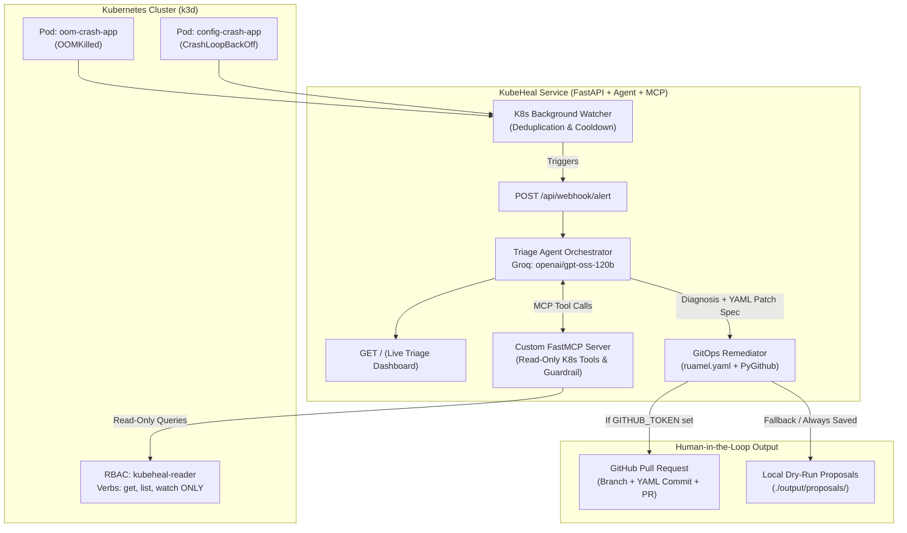

# Implementation Plan: KubeHeal — Guardrailed Kubernetes AIOps Triage Agent (with MCP)

## Goal Description

Build **KubeHeal**, an autonomous yet strictly guardrailed Kubernetes AIOps Triage Agent. When a pod in a Kubernetes (`k3d`) cluster enters `CrashLoopBackOff` or `OOMKilled`, a lightweight watcher (or external webhook) triggers a **FastAPI** service. The service spins up an AI Triage Agent powered by **Groq (`openai/gpt-oss-120b`)** connected to a custom **Model Context Protocol (MCP)** server (`mcp` Python SDK v2.3.0).

Through the MCP server, the agent executes **strictly read-only** Kubernetes inspections (`get_pod_logs`, `get_pod_events`, `get_deployment_spec`, and a guardrailed `run_readonly_kubectl` wrapper), diagnoses the root cause, generates a safe YAML remediation patch using `ruamel.yaml`, and either opens a **GitHub Pull Request** via **PyGithub** for human approval or outputs a complete local PR bundle in dry-run mode. A **Live Web Dashboard** on FastAPI visualizes real-time alerts, MCP tool traces, root-cause analysis, YAML diffs, and PR links.

---

## User Review Required

> [!IMPORTANT]
> **3-Layer Defense-in-Depth Guardrails**
> 1. **Code-Level MCP Guardrail**: Only dedicated read-only tools and an allow-listed `kubectl` validator (`get`, `describe`, `logs`, `events`, `top`) are exposed. Mutating verbs (`delete`, `apply`, `patch`, `edit`, `exec`, `scale`, `rollout`) and shell metacharacters (`;`, `|`, `&`, `>`, `$`) are rejected before execution.
> 2. **Cluster-Level RBAC Guardrail**: `k8s/rbac/readonly-triage-rbac.yaml` provisions a `ServiceAccount` (`kubeheal-reader`) restricted to `["get", "list", "watch"]` verbs at the Kubernetes API server level.
> 3. **GitOps Human-in-the-Loop Guardrail**: The agent never mutates live cluster state directly; all remediations are proposed as GitHub Pull Requests (or local dry-run patch files) modifying deployment YAML manifests.

> [!NOTE]
> **Verified Technology Versions (via Context7)**
> - **Python**: `>=3.11,<3.13`
> - **FastAPI**: `0.162.0` (`fastapi[standard]`) + **Pydantic**: `2.10.6` (`pydantic-settings==2.8.0`)
> - **MCP Python SDK**: `mcp[cli]==2.3.0` (`FastMCP`)
> - **LLM Engine**: **Groq API** (`groq>=0.18.0` / `httpx==0.28.1`) using model `openai/gpt-oss-120b`
> - **Kubernetes Client**: `kubernetes==37.0.2` + `k3d` (`v5.9.0`)
> - **GitOps & YAML**: `PyGithub==2.10.0` + `ruamel.yaml==0.18.10`

---

## System Architecture



---

## Proposed Changes

### 1. Project Configuration & Dependencies

#### [NEW] [pyproject.toml](file:///d:/KubeHeal/pyproject.toml)
Defines project metadata, Python `>=3.11` constraint, dependencies (`fastapi[standard]==0.162.0`, `mcp[cli]==2.3.0`, `PyGithub==2.10.0`, `kubernetes==37.0.2`, `ruamel.yaml==0.18.10`, `groq`, `httpx==0.28.1`, `pytest`, `pytest-asyncio`), and pytest settings.

#### [NEW] [requirements.txt](file:///d:/KubeHeal/requirements.txt)
Pinned dependency file for standard `pip install -r requirements.txt` and Docker builds.

#### [NEW] [.env.example](file:///d:/KubeHeal/.env.example)
Template environment configuration:
```ini
# AI Provider (Groq)
GROQ_API_KEY=your_groq_api_key_here
GROQ_MODEL=openai/gpt-oss-120b

# Kubernetes Settings
KUBE_NAMESPACE=default
ENABLE_K8S_WATCHER=true
WATCHER_POLL_INTERVAL_SECONDS=15
ALERT_COOLDOWN_SECONDS=300
MANIFESTS_DIR=k8s/workloads

# GitHub PR Automation (Leave token empty for Local Dry-Run Mode)
GITHUB_TOKEN=
GITHUB_REPO=owner/repo-name
GITHUB_BASE_BRANCH=main
DRY_RUN_MODE=true
```

---

### 2. Core Configuration & Data Models (`src/kubeheal/`)

#### [NEW] [config.py](file:///d:/KubeHeal/src/kubeheal/config.py)
Uses `pydantic-settings` (`BaseSettings`) to load environment variables from `.env`, supporting both host development and in-cluster configurations.

#### [NEW] [models.py](file:///d:/KubeHeal/src/kubeheal/models.py)
Pydantic v2 models for:
- `AlertPayload`: Incoming webhook payload (`pod_name`, `namespace`, `deployment_name`, `reason` e.g. `OOMKilled` / `CrashLoopBackOff`, `exit_code`, `message`).
- `MCPToolExecution`: Audit log entry for every MCP tool call (`tool_name`, `arguments`, `output_preview`, `blocked_by_guardrail`, `timestamp`).
- `YAMLModification`: Structured remediation change (`file_path`, `container_name`, `parameter_path`, `old_value`, `new_value`, `rationale`).
- `TriageReport`: Full diagnosis report (`incident_id`, `status`, `alert`, `root_cause_summary`, `confidence`, `mcp_traces`, `proposed_fix`, `yaml_diff`, `pr_url`, `local_proposal_path`).

---

### 3. Custom Guardrailed MCP Server (`src/kubeheal/mcp_server/`)

#### [NEW] [guardrails.py](file:///d:/KubeHeal/src/kubeheal/mcp_server/guardrails.py)
Implements strict validation for any Kubernetes inspection request:
- `ALLOWED_KUBECTL_VERBS = {"get", "describe", "logs", "events", "top"}`
- `FORBIDDEN_KUBECTL_VERBS = {"delete", "apply", "patch", "edit", "exec", "run", "create", "replace", "scale", "rollout", "cordon", "drain", "taint", "label", "annotate", "port-forward", "cp", "auth"}`
- Blocks shell injection characters (`;`, `|`, `&`, `$`, `` ` ``, `>`, `<`) and sensitive flag access (`--token`, `--kubeconfig`, `-o jsonpath` secret extraction, `secrets` resource type).

#### [NEW] [server.py](file:///d:/KubeHeal/src/kubeheal/mcp_server/server.py)
Built with `mcp.server.fastmcp.FastMCP("kubeheal-k8s-mcp")`. Provides:
1. `@mcp.tool() get_pod_status(pod_name: str, namespace: str = "default")`: Inspects container state, restart count, last termination state (`OOMKilled`, `Error`, `exitCode`), and current resource requests/limits.
2. `@mcp.tool() get_pod_logs(pod_name: str, namespace: str = "default", tail_lines: int = 100, previous: bool = True)`: Fetches current and previous crashed container logs.
3. `@mcp.tool() get_pod_events(pod_name: str, namespace: str = "default")`: Fetches Kubernetes Warning/Normal events associated with the pod.
4. `@mcp.tool() get_deployment_spec(deployment_name: str, namespace: str = "default")`: Returns the deployment's container image, command/args, non-secret env vars, and resource requests/limits.
5. `@mcp.tool() run_readonly_kubectl(command: str)`: Validates `command` through `validate_kubectl_command()` guardrail before executing `kubectl` subprocess with a 10-second timeout.

---

### 4. AI Triage Agent & Groq Orchestrator (`src/kubeheal/agent/`)

#### [NEW] [triage_agent.py](file:///d:/KubeHeal/src/kubeheal/agent/triage_agent.py)
Connects the Groq LLM (`openai/gpt-oss-120b`) with the MCP Server tools:
- Discovers tools registered on the FastMCP server and converts them to OpenAI/Groq tool-calling schema.
- Runs a bounded agentic loop (max 6 tool iterations) where the LLM inspects pod status, events, logs, and deployment specs via MCP tools.
- Records every MCP tool call and guardrail verification in `mcp_traces`.
- Produces a structured JSON diagnosis containing the root cause explanation, recommended resource/env changes, and PR description.

---

### 5. GitOps YAML Remediator & PyGithub PR Service (`src/kubeheal/gitops/`)

#### [NEW] [yaml_patcher.py](file:///d:/KubeHeal/src/kubeheal/gitops/yaml_patcher.py)
Uses `ruamel.yaml` to safely parse and update Kubernetes Deployment manifests in `k8s/workloads/` while preserving comments and formatting:
- Supports bumping `resources.limits.memory`, `resources.requests.memory`, `resources.limits.cpu`, updating safe config environment variables, or fixing container arguments.
- Enforces **Remediation Guardrails** (e.g., caps memory limit bumps to a safe maximum like `1Gi` so the AI cannot allocate `64Gi` and starve the node).
- Generates a unified diff (`difflib.unified_diff`) for the dashboard and PR body.

#### [NEW] [github_pr.py](file:///d:/KubeHeal/src/kubeheal/gitops/github_pr.py)
Uses `PyGithub` (`github.Auth.Token`):
- **Local Proposal Output (Always saved)**: Writes the patched YAML and a formatted Markdown PR report to `output/proposals/<incident_id>/`.
- **Live GitHub PR Mode (When `GITHUB_TOKEN` & `GITHUB_REPO` are set and `DRY_RUN_MODE=false`)**:
  1. Authenticates via `Auth.Token(settings.github_token)`.
  2. Creates branch `fix/kubeheal-<deployment>-<short_id>` from `GITHUB_BASE_BRANCH`.
  3. Commits the updated deployment YAML via `repo.update_file()`.
  4. Opens a Pull Request with root-cause diagnosis, MCP evidence logs, and guardrail verification checklist.

---

### 6. Kubernetes Background Watcher (`src/kubeheal/watcher/`)

#### [NEW] [k8s_watcher.py](file:///d:/KubeHeal/src/kubeheal/watcher/k8s_watcher.py)
- Periodically polls pods in the configured namespace (or uses K8s watch stream) to detect containers in `Waiting` (`CrashLoopBackOff`) or `Terminated` (`OOMKilled` / non-zero exit code).
- Implements a per-deployment cooldown cache (`ALERT_COOLDOWN_SECONDS=300`) so a crashing pod only triggers one triage workflow per cooldown window.
- Posts detected crashes to the FastAPI `/api/webhook/alert` handler.

---

### 7. FastAPI Server & Live Web Dashboard (`src/kubeheal/main.py` & `static/`)

#### [NEW] [main.py](file:///d:/KubeHeal/src/kubeheal/main.py)
FastAPI application providing:
- `GET /`: Serves the Live Triage Web Dashboard.
- `GET /api/health`: Health, cluster connectivity, MCP tool count, and guardrail status check.
- `POST /api/webhook/alert`: Receives crash alerts (from K8s watcher, Alertmanager, or manual test) and triggers the async triage pipeline.
- `POST /api/simulate/{scenario}`: One-click simulation endpoints (`oom-crash` and `config-crash`) so you can test the entire AI + MCP + YAML Patch + PR pipeline even before `k3d` is running, or against live `k3d` pods.
- `POST /api/guardrail-test`: Endpoint to test the MCP guardrail against a forbidden command (e.g., `kubectl delete pod --all`) and see it blocked live on the dashboard.
- `GET /api/incidents`: Returns all triage reports and live statuses.

#### [NEW] [index.html](file:///d:/KubeHeal/src/kubeheal/static/index.html)
Clean, modern dark-themed AIOps Triage Dashboard displaying:
- Cluster & Guardrail Status badges (`MCP Read-Only Active`, `Groq gpt-oss-120b`, `GitOps PR Mode`).
- Quick Trigger buttons (`Trigger OOMKilled Triage`, `Trigger CrashLoopBackOff Triage`, `Test Guardrail Block`).
- Incident Timeline showing step-by-step MCP tool calls, AI root-cause diagnosis, side-by-side/unified YAML diff, and the generated GitHub PR link / local proposal file.
- *Note: Use the frontend-design skill when making the frontend dashboard.*

---

### 8. Kubernetes Manifests, `k3d` Scripts, Docker & CI/CD

#### [NEW] [readonly-triage-rbac.yaml](file:///d:/KubeHeal/k8s/rbac/readonly-triage-rbac.yaml)
Defines `ServiceAccount: kubeheal-reader`, `ClusterRole: kubeheal-readonly-role` (strictly `get`, `list`, `watch`), and `ClusterRoleBinding`.

#### [NEW] [oom-crash-app.yaml](file:///d:/KubeHeal/k8s/workloads/oom-crash-app.yaml)
Sample deployment (`oom-crash-app`) with a tight `32Mi` memory limit that allocates ~60MB in Python, reliably triggering `OOMKilled` (Exit Code 137).

#### [NEW] [config-crash-app.yaml](file:///d:/KubeHeal/k8s/workloads/config-crash-app.yaml)
Sample deployment (`config-crash-app`) with `REQUIRED_PORT` misconfigured as `"invalid_port"` and `MEMORY_LIMIT` too low, reliably triggering `CrashLoopBackOff` (Exit Code 1) with clear diagnostic logs.

#### [NEW] [agent-deployment.yaml](file:///d:/KubeHeal/k8s/agent/agent-deployment.yaml) & [Dockerfile](file:///d:/KubeHeal/Dockerfile)
Containerizes KubeHeal on `python:3.12-slim` with `kubectl` installed and deploys it inside the cluster using `serviceAccountName: kubeheal-reader`.

#### [NEW] [setup-k3d.ps1](file:///d:/KubeHeal/scripts/setup-k3d.ps1) & [setup-k3d.sh](file:///d:/KubeHeal/scripts/setup-k3d.sh)
Automated scripts for Windows PowerShell and Linux/Codespaces to create the `kubeheal-cluster` in `k3d`, apply RBAC, and deploy the broken demo pods.

#### [NEW] [ci-validate.yml](file:///d:/KubeHeal/.github/workflows/ci-validate.yml)
GitHub Actions workflow that runs pytest (guardrail security tests, YAML patcher tests, webhook API tests) on every push and pull request.

---

## Verification Plan

### Automated Tests (`pytest`)
We will create a comprehensive test suite under `tests/`:
1. **`tests/test_guardrails.py`**: Verifies that allowed commands (`kubectl get pods`, `kubectl logs`, `kubectl describe`) pass and mutating/malicious commands (`kubectl delete`, `kubectl apply`, `kubectl exec`, `kubectl get pods; rm -rf /`, `kubectl get secrets`) are strictly blocked.
2. **`tests/test_yaml_patcher.py`**: Verifies that `ruamel.yaml` accurately updates memory limits and environment variables in `oom-crash-app.yaml` and `config-crash-app.yaml`, preserves comments, enforces maximum memory caps, and produces a valid unified diff.
3. **`tests/test_webhook_and_agent.py`**: Tests the FastAPI `/api/webhook/alert`, `/api/simulate/{scenario}`, and `/api/guardrail-test` endpoints end-to-end.

Command to run automated tests:
```powershell
pytest -v
```

### Manual Verification
1. Set `GROQ_API_KEY` in `.env` and start the FastAPI server locally:
   ```powershell
   uvicorn kubeheal.main:app --reload --app-dir src --port 8000
   ```
2. Open `http://localhost:8000` in your browser to view the **KubeHeal Live Triage Dashboard**.
3. Click **"Trigger OOMKilled Triage"**, **"Trigger CrashLoopBackOff Triage"**, or run `./scripts/setup-k3d.ps1` to watch live `k3d` pods crash and get automatically triaged with generated YAML diffs and PR proposals.
